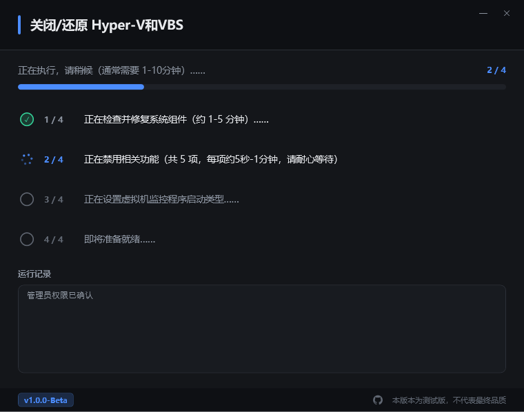

# DisableVBS

关闭 / 还原 Windows 的 **VBS（基于虚拟化的安全）** 与 **内存完整性（HVCI）**，带图形界面与执行日志。
A GUI tool to disable or restore **Virtualization-Based Security (VBS)** and **HVCI** on Windows.

> ⚠️ **本版本为测试版，不代表最终品质。**
> This is a **beta build**. Use at your own risk.

[中文说明](#中文) · [English](#english)

---

## 中文

### 这是什么

一个单文件 Windows 桌面工具，用来关闭或还原 VBS / HVCI / Hyper-V 相关启动配置。适用于：

- 需要运行 VMware 等虚拟机，但 VBS 占用 / 冲突
- 系统安全策略自动把已关闭的 VBS 又打开
- 想看清楚每一步到底执行了什么、返回码是什么

### 为什么要做

Windows 10/11 上关闭 VBS 不只是改一个开关。它涉及可选功能（dism）、启动配置（bcdedit）、注册表策略，以及一次 SecConfig 引导项配置。手工做容易漏步骤，而漏掉关键一项会导致「关掉了但重启后又被打开」。

本工具把这些步骤固定下来，并且**把每一步的返回码显示出来**，失败时写日志。

### 功能

| 菜单 | 作用 |
|---|---|
| 1 | 关闭 VBS 和 HVCI（可选功能 + 注册表 + 启动配置 + SecConfig） |
| 2 | 还原 VBS 和 HVCI |
| 3 | 打开系统配置（dxdiag），只读 |
| 4 | 打开 Windows 安全中心 · 内核隔离，只读 |
| 5 | 为家庭版安装 Hyper-V 组件（装完必须重启） |
| 0 | 退出 |

界面底部会显示四项实时状态：VBS、HVCI、Hypervisor 启动类型、Hyper-V 功能。

### 界面

| 主界面 | 执行中 |
|---|---|
|  |  |

| 完成 | 重启 |
|---|---|
|  |  |

### 已验证环境

| 系统 | 菜单 1（关闭） | 菜单 2（还原） |
|---|---|---|
| Windows 11 26H2 家庭版 26300.9550 | ✅ 含二次重启不复燃 | ✅ |

其他版本尚未逐一验证。**欢迎提 Issue 报告你的系统版本与结果。**

### 版本沿革

本项目的早期版本是一个命令行 `.bat` 脚本，通过网络分发加密后的 exe。它验证了这套操作序列在多种 Windows 版本上的可行性，但也带来两个问题：

1. **用户无法核验内容** —— 加密壳使得任何外部审计都不可能，唯一背书只能是「发布者说它跑过」
2. **界面受限** —— 控制台能表达的东西很有限，进度、失败原因、日志都只能靠一行行滚动的文字

`v1.0.0-Beta` 是**独立重写**：图形界面 + 完全开源的 C# 实现，构建只需要系统自带的 `csc.exe`。

旧的命令行版本（[Gitee: HOSHINO6/DisableVBS](https://gitee.com/HOSHINO6/DisableVBS)）**已停止维护**，仅作为历史版本保留。

> 保留了原版的全部系统操作序列与返回码判定逻辑，逐条对照见 [docs/bat-to-csharp-对照表.md](docs/bat-to-csharp-对照表.md)。

### 已知限制

- 重启是必需的，工具会提示并可以代你重启（带 3 秒倒计时，可取消）
- 执行前会检测「待处理变更」，若有未重启完成的系统变更会阻止继续执行
- 大版本更新后 VBS 状态是否保持，尚未验证
- 菜单 5 在非家庭版上可能导致无法进入系统 —— 请先备份

### 使用

1. 下载 Releases 中的 `DisableVBS_v1.0.0-Beta.exe`
2. 双击运行，接受 UAC 提权提示（本工具必须管理员权限）
3. 按菜单选择操作
4. 完成后按提示重启

> 重启过程中若出现黑底白字的英文界面，请连续按 `F3` 走完剩余流程。

### 构建

不需要安装 .NET SDK 或 Visual Studio，系统自带的 `csc.exe` 即可：

```powershell
powershell -ExecutionPolicy Bypass -File .\build.ps1
```

产物为 `DisableVBS_v1.0.0-Beta.exe`，依赖 .NET Framework 4.8（Windows 10 1809+ / Windows 11 自带）。

### 安全说明

这个工具会：

- 修改 `HKLM\SYSTEM\CurrentControlSet\Control\DeviceGuard` 下的策略值
- 修改启动配置（`bcdedit`），添加一个 SecConfig 引导项
- 启用 / 禁用 Windows 可选功能（`dism`）
- 修改 `X:`（EFI 分区）中的 `SecConfig.efi`

源码全部公开，可自行审计与编译。**建议在操作前创建系统还原点。**

### 许可

MIT License，见 [LICENSE](LICENSE)。

---

## English

**DisableVBS** turns Virtualization-Based Security (VBS) and HVCI off — or back on — on Windows 10/11, through a small WinForms/WPF-style GUI that shows every command's exit code.

- **Why**: disabling VBS touches optional features, boot configuration, registry policy and a SecConfig boot entry. Miss one and Windows quietly re-enables it after the next reboot. This tool keeps the sequence fixed and shows you what each step returned.
- **Verified**: Windows 11 26H2 Home (26300.9550) — disable and restore both pass, including a second reboot check.
- **Requires**: Windows 10 1809+ / Windows 11, .NET Framework 4.8 (built in), administrator rights.
- **Build**: no SDK needed — `powershell -ExecutionPolicy Bypass -File .\build.ps1`, using the in-box `csc.exe`.
- **Warning**: this tool modifies registry, BCD, optional features and the EFI partition. Create a restore point first. This is a beta build.

MIT licensed.
